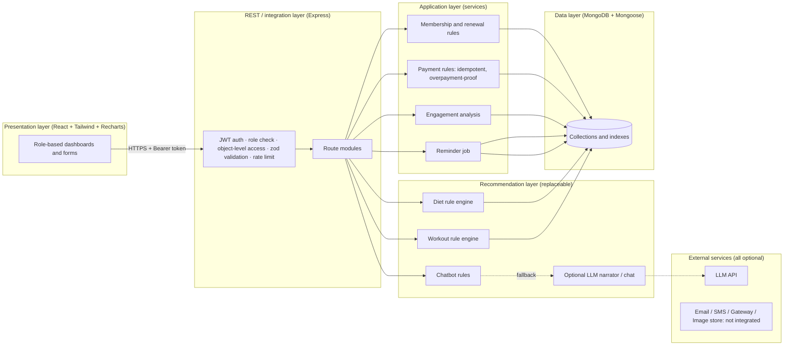
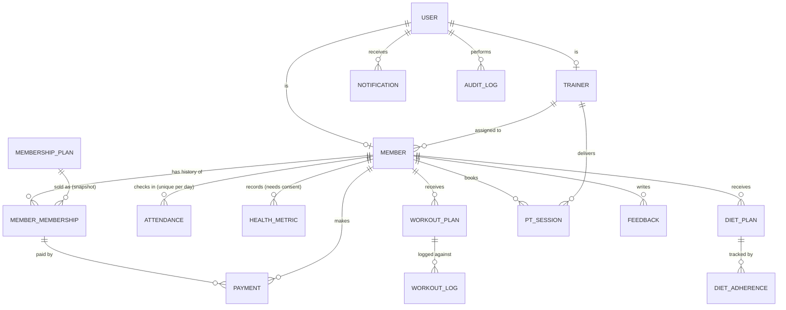
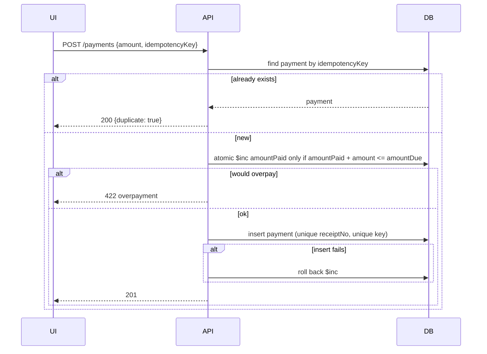

# Architecture

## Layers and data flow

The AI layer is isolated in `services/dietEngine.js`, `workoutEngine.js`, `chatbotRules.js`, `coach.js` and `llm.js`. Swapping the LLM provider means editing only `llm.js`.

## Entity relationships

Key constraints: unique `User.email`, `Member.phone`, `Member.memberCode`, `Payment.receiptNo`, `Payment.idempotencyKey` (sparse), `Attendance(member, dayKey)`, `Notification(user, dedupeKey)` (partial), `DietAdherence(plan, day, slot)`. Memberships, payments and attendance are append-only history: renewals and plan changes create new documents.

## Sequence: payment (why double-clicks cannot double-charge)

## Use cases

Admin: manage plans, trainers, settings; see revenue, workload, audit log; refund. Staff: register, assign/renew, check in, record payments, print receipts. Trainer: review assigned members, approve or edit plans, record assessments, schedule sessions. Member: view membership, check in by QR, track health (with consent), generate plans, log workouts and meals, chat, request help.
